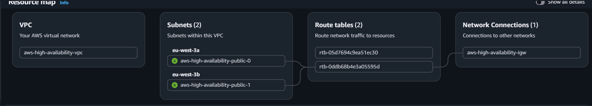
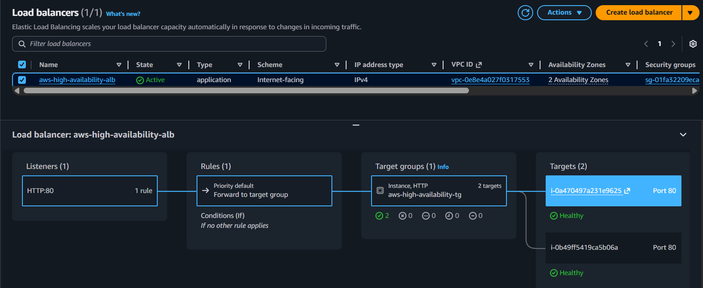
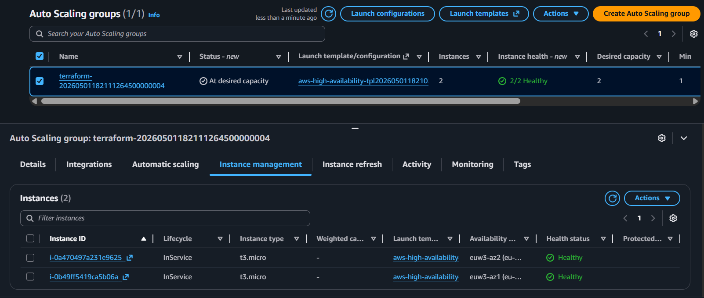

# AWS High-Availability Web Cluster with Terraform
> [!NOTE]
> **This project is archived.** A more complete and more recent Terraform project (ECS Fargate, RDS PostgreSQL, GitHub Actions CI) is available in [aws-terraform-infra](https://github.com/greeg75/aws-terraform-infra).


## 📌 Project Overview

This project demonstrates the deployment of a **highly available and scalable** web infrastructure on AWS using **Infrastructure as Code (Terraform)**. 

Instead of managing individual servers manually, this architecture leverages an **Auto Scaling Group** and an **Application Load Balancer** to ensure the application remains reachable and resilient to data center failures. 

---

## 🗺️ Architecture Diagram

Below is the visual representation of the infrastructure. It illustrates how traffic flows from the Internet through the Load Balancer to the EC2 instances distributed across multiple Availability Zones.


---

## Architecture Features

*   **Networking**: Custom VPC with Multi-AZ (Availability Zones) public subnets for high availability.

*   **Load Balancing**: Application Load Balancer (ALB) acting as a single entry point, distributing traffic across multiple instances.

*   **Scalability**: Auto Scaling Group (ASG) configured to maintain a desired capacity of 2 instances, with self-healing capabilities.

*   **Security**: 

    *   Tiered Security Groups: EC2 instances only accept traffic from the ALB.
    *   Automated provisioning via UserData scripts.

*   **Modular IaC**: Clean and professional Terraform structure using reusable modules (`vpc`, `alb`, `compute`).

---

## Project Structure

```text
.
├── main.tf                 # Root module calling sub-modules
├── variables.tf            
├── outputs.tf              # Root outputs (Load Balancer URL)
├── terraform.tfvars        # Environment configuration
├── modules/
│   ├── vpc/                # Networking & IGW 
│   ├── alb/                # Load Balancer & Security Groups
│   └── compute/            # Launch Template Instance & Auto Scaling
└── README.md
```
---

## Detailed Module Breakdown & Implementation

### 1. Networking Module (VPC)

The foundation of the cluster. It creates an isolated network environment spread across two Availability Zones for redundancy.

*   **Key Components**: VPC, 2 Public Subnets, Internet Gateway, and Route Tables.

*   **Visual on AWS**: 

### 2. Load Balancing Module (ALB)

The intelligent entry point that manages incoming HTTP traffic.

*   **Key Components**: Application Load Balancer, Listener (Port 80), and Target Group.

*   **Health Checks**: Configured to ping `/` every 30 seconds to ensure traffic only reaches healthy instances.

*   **Visual on AWS**: 

### 3. Compute Module (Instance Template & Auto Scaling Group)

The "muscle" of the infrastructure. It manages the lifecycle of the web servers.

*   **Key Components**: Launch Template (Amazon Linux 2023), Auto Scaling Group.

*   **Automation**: Uses `User Data` to automatically install Apache and deploy the "Hello World" landing page.

*   **Visual Proof**: 

---

## How to Deploy the Infrastructure with Terraform

```bash

terraform init

terraform fmt

terraform plan

terraform apply

terraform destroy

```
---

## Project Outcomes

The successful deployment of this project resulted in several key infrastructure improvements:

*   **Zero-Downtime Resilience**: By implementing a Multi-AZ architecture, the application remains accessible even if one AWS Availability Zone (data center) undergoes an outage.

*   **Rapid Provisioning**: The entire infrastructure (Network, Load Balancer, and Auto-Scaling Cluster) is deployed from scratch in less than **5 minutes** using a single command, significantly reducing time-to-market compared to manual setup.

*   **Self-Healing Capabilities**: The Auto Scaling Group was tested to automatically detect and replace "unhealthy" instances, ensuring the desired capacity of 2 servers is maintained without human intervention.

*   **Validated Accessibility**: The project outcome is a fully functional web environment accessible via a unique DNS entry point, demonstrating successful integration of global traffic management.

*   **Cost & Resource Optimization**: Used `t3.micro` instances and automated cleanup (`terraform destroy`) to demonstrate responsible cloud cost management.

---

## AWS Services & Tools

*   **Cloud**: AWS (VPC, EC2, ALB, ASG)
*   **IaC**: Terraform 
*   **Version Control**: Git

---

## References & Documentation

*   [Terraform AWS Provider Documentation](https://registry.terraform.io/providers/hashicorp/aws/latest/docs): Used for resource configuration and attribute mapping.

*   [AWS Best Practices for VPC](https://docs.aws.amazon.com/vpc/latest/userguide/vpc-best-practices.html): Followed for Multi-AZ subnet design.

---

## Key Learnings

Through this project, I have significantly improved my skills in:

**Modular Terraform Development**: Mastering how to build and link independent infrastructure blocks.

**Cloud Resilience**: Designing architectures that can survive a data center outage (Multi-AZ).

**Documentation-Driven Development**: Effectively using the official Terraform Registry to implement standard cloud patterns.

**Security-by-Design**: Implementing the principle of least privilege through refined Security Group ingress/egress rules.

---

## Final Note:

Beyond the code, this project represents my transition from manual infrastructure management to Infrastructure as Code (IaC).

In a modern cloud environment, the ability to provision consistent and reproducible infrastructure in minutes rather than hours or days provides a significant operational advantage. This project demonstrates my ability to:

1.  **Standardize** deployments and eliminate configuration drift.

2.  **Scale** infrastructure dynamically based on demand without manual intervention.

3.  **Secure** cloud environments by design through automated and repeatable configurations.

Overall, this project reflects an automation-first mindset focused on reliability, scalability, and operational efficiency in cloud-native environments.

---

## Author

Grégory JACQUET

Aspiring Cloud DevOps / Cloud Engineer Security

LinkedIn : https://www.linkedin.com/in/gregoryjacquet/

This project was designed and implemented as part of a personal initiative to develop hands-on skills in AWS Cloud, Security, Infrastructure Architecture, and Infrastructure as Code (IaC) using Terraform.
